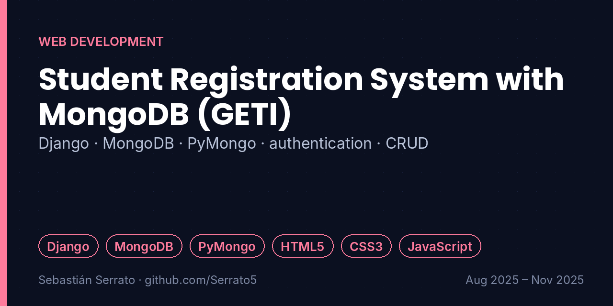
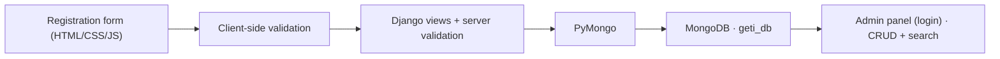

# Student Registration System with MongoDB (GETI)

**Django · MongoDB · PyMongo · authentication · CRUD**

`Django` `MongoDB` `PyMongo` `HTML5` `CSS3` `JavaScript`

## Overview

Web application for the voluntary registration and administrative management of students in the GETI community, integrating a Django backend with a non-relational database (Programming II, Universidad Surcolombiana).

## Key features

- **NoSQL integration:** Design of the geti_db database in MongoDB with collections managed through PyMongo.
- **Backend and authentication:** Server logic in Django with dynamic routing, session control and a password-protected Administration Module.
- **Admin panel (CRUD):** Real-time listing of records, search by ID number or academic program, and insertion, editing and deletion of data.
- **Validation:** Client-side and server-side validation: mandatory institutional email format (@usco.edu.co) and prevention of duplicate records.

## How it works

## What I learned

- Document databases vs. relational tables.
- Never trust only client-side validation: validate on the server too.
- Protecting admin functions with sessions and authentication.

## Project context

| | |
|---|---|
| Context | Programming II · Universidad Surcolombiana |
| Dates | Aug 2025 – Nov 2025 |
| Area | Web Development |
| Related project | [web-geti-django](https://github.com/Serrato5/web-geti-django) |

## Resumen en español

Aplicación web para el registro de estudiantes de la comunidad GETI: Django con MongoDB (PyMongo), módulo de administración con contraseña, CRUD con búsqueda por documento o programa, y validaciones de correo institucional (@usco.edu.co) y de duplicados.

---

**About this repository:** the original source code and design files of this project were not preserved. This repository documents what was built, how it works and what I learned, based on my project records. It does not contain reconstructed code.

**Sobre este repositorio:** el código y los archivos originales de este proyecto no se conservaron. Aquí se documenta qué se construyó, cómo funciona y qué aprendí, sin código reconstruido.

**Author:** Sebastián Serrato Ramírez · Electronic Engineering student, Universidad Surcolombiana (Neiva, Colombia) · [LinkedIn](https://www.linkedin.com/in/sebaserrato) · [More projects](https://github.com/Serrato5)
